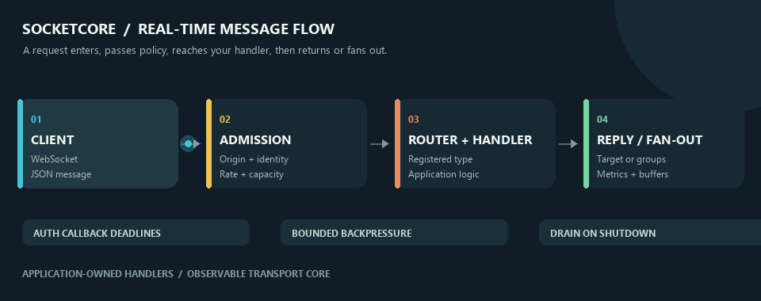
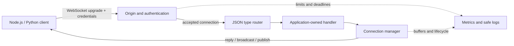

# SocketCore

<p align="center">
  <strong>A reusable WebSocket core for real-time Node.js applications.</strong><br>
  Authenticated connections, message routing, backpressure, and graceful shutdown.
</p>

<p align="center">
  
</p>

<p align="center">
  <a href="#quick-start">Quick start</a> ·
  <a href="#feature-map">Feature map</a> ·
  <a href="#how-it-works">How it works</a> ·
  <a href="docs/ENGINE_API.md">Engine API</a> ·
  <a href="docs/PRODUCTION_DEPLOYMENT.md">Deployment guide</a>
</p>

<p align="center">
  
  
  
</p>

SocketCore is a configurable Node.js WebSocket engine for authenticated real-time messaging. It manages connections and message flow while your application owns authentication policy, business handlers, and the HTTP or HTTPS server.

> **At a glance:** provide an auth callback, register handlers by message type, attach to your server, then start. The standalone sample is plain HTTP; the local load results are exploratory and are not a production capacity guarantee.

## Contents

- [Quick Start](#quick-start)
- [How It Works](#how-it-works)
- [Feature Map](#feature-map)
- [Built-In Messages](#built-in-messages)
- [Use as a Library](#use-as-a-library)
- [Configuration](#configuration)
- [Tests and Load Study](#tests-and-load-study)
- [Security and Deployment](#security-and-deployment)
- [Project and License](#project-and-license)

## Quick Start

Requirements: Node.js `>=20`, npm, and an authentication token for the sample app.

```sh
npm install
```

Start the standalone sample with a local token.

PowerShell:

```powershell
$env:AUTH_TOKENS = "local-client-token"
npm start
```

POSIX shell:

```sh
AUTH_TOKENS='local-client-token' npm start
```

Connect to `ws://localhost:8080` using the `x-auth-token` header:

```js
const WebSocket = require("ws");

const socket = new WebSocket("ws://localhost:8080", {
  headers: { "x-auth-token": process.env.WS_TOKEN },
});

socket.on("message", (data) => {
  console.log(JSON.parse(data.toString()));
});

socket.on("open", () => {
  socket.send(JSON.stringify({ type: "status", data: { request: "health" } }));
});
```

The `health` request exercises the status echo handler; it is not an HTTP or process-health endpoint. The app reads environment variables directly, does not load `.env` files, uses plain HTTP, and does not enforce a URL path. See [User Guide](docs/USER_GUIDE.md) for admin setup and client details.

## How It Works



1. The host app creates `createEngine()` with a required `authenticate(req)` callback.
2. SocketCore checks the optional Origin policy, bounds async origin/auth callbacks, and applies admission limits.
3. The router decodes JSON and selects a handler registered for the message `type`.
4. The handler replies to its client or uses the connection manager for authorized group operations and fan-out.
5. The manager applies send-buffer policy, while metrics/log hooks expose activity and shutdown drains connections within a deadline.

## Feature Map

| Capability                   | What it does                                                                                                                               | How to use it                                                                                                         |
| ---------------------------- | ------------------------------------------------------------------------------------------------------------------------------------------ | --------------------------------------------------------------------------------------------------------------------- |
| Authentication and Origin    | Requires an application auth callback; optionally allows exact origins or an origin callback. Missing Origin is allowed.                   | Configure `authenticate` and `allowedOrigins` in `createEngine`; sample app uses `AUTH_TOKENS` and `ALLOWED_ORIGINS`. |
| Typed JSON routing           | Decodes JSON, routes by string `type`, and reports malformed or unknown messages.                                                          | Register an async handler with `engine.register(type, handler)`.                                                      |
| Connection lifecycle         | Tracks identity, client IDs, groups, sends, heartbeat state, and shutdown.                                                                 | Use `connectionManager` or handler context methods.                                                                   |
| Subscriptions                | Authorizes group joins through the same callback for context and direct manager calls; default is deny.                                    | Supply `authorizeSubscription`; await `ctx.subscribe(group)`.                                                         |
| Admission and message limits | Bounds connections, pending upgrades, frame size, per-client rate, and in-flight work.                                                     | Configure `limits`; see [all environment options](docs/CONFIGURATION.md).                                             |
| Backpressure                 | Closes slow clients above per-client buffering limit; optional aggregate pending-send cap rejects a send without disconnecting the target. | Configure `maxBufferedBytes` and, after workload sizing, `maxTotalBufferedBytes`.                                     |
| Heartbeat                    | Pings clients and terminates stale connections based on pong age.                                                                          | Configure `heartbeatIntervalMs` and `staleThresholdMs`; zero interval disables the timer.                             |
| Callback deadlines           | Bounds Origin and authentication callback wait time and releases pending-upgrade capacity on timeout.                                      | Configure `originCheckMs` and `authenticateMs`; callback Promise work itself cannot be forcibly cancelled.            |
| Graceful drain               | Stops upgrade admission, closes clients, waits for close events, then terminates remaining sockets after the deadline.                     | Await `engine.stop()` before closing the host HTTP/HTTPS server.                                                      |
| Metrics and logging          | Offers counter, gauge, observation, and logger callbacks with error-detail redaction in engine helper logs.                                | Pass `metrics` and `logger`; connect metrics to your own exporter. No backend is bundled.                             |
| Sample handlers              | Includes `status` and `command` examples outside the transport core.                                                                       | Run `npm start`, or register your own handlers in a library application.                                              |
| Python load harness          | Measures status replies, fan-out, reconnects, latency, and local process resources.                                                        | Follow [Load Testing](docs/LOAD_TESTING.md); this is exploratory loopback evidence only.                              |

## Built-In Messages

The standalone app registers `status` and `command`; library consumers can register their own message types.

| Request                                  | Access               | Behavior                                                              |
| ---------------------------------------- | -------------------- | --------------------------------------------------------------------- |
| `{ "type":"status", "data":{...} }`      | Authenticated client | Replies with acknowledgement, server time, and echoed data.           |
| `status` with `data.request: "snapshot"` | Admin                | Returns managed connection count and server time.                     |
| `status` with `data.broadcast: true`     | Admin                | Sends status to every other connection; sender gets no success reply. |
| `command` with `name: "ping"`            | Authenticated client | Returns `{ pong:true, at:<unix-ms> }`.                                |
| `command` with `name: "echo"`            | Authenticated client | Returns `args`, or `null`.                                            |
| `command` with `name: "broadcast"`       | Admin                | Sends `args` to other clients and returns the successful send count.  |
| `command` with `name: "shutdown-client"` | Admin                | Closes the specified client with code `1000`.                         |

Example ping exchange:

```json
{ "type": "command", "name": "ping" }
```

```json
{
  "type": "command",
  "name": "ping",
  "result": { "pong": true, "at": 1793217600000 }
}
```

Broadcast counts measure successful `ws.send` calls; they do not prove that recipients processed a message. See [Protocol Reference](docs/WEBSOCKET_PROTOCOL.md) for complete schemas, errors, access rules, and close codes.

## Use as a Library

The package root exports `createEngine`. The embedding application creates and owns its HTTP/HTTPS server, TLS, routes, and listen lifecycle.

```js
const { createEngine } = require("configurable-websocket-engine");

const engine = createEngine({
  authenticate: async (req) => verifyApplicationCredential(req),
  allowedOrigins: ["https://client.example"],
  authorizeSubscription: async (identity, group) =>
    identity.allowedGroups?.includes(group) ?? false,
});

engine.register("status", async (ctx, message) => {
  ctx.reply({ type: "status", data: message.data ?? {} });
});

// `server` is the application's existing HTTP(S) server.
engine.attach(server);
engine.start();

async function shutdown() {
  await engine.stop();
  await closeHttpServer(server);
}
```

`verifyApplicationCredential`, `server`, and `closeHttpServer` are application-owned. For callback contracts, lifecycle, metrics, and manager APIs, see [Engine API](docs/ENGINE_API.md).

## Configuration

The package itself reads no environment variables. The standalone app maps its environment to engine settings; these are the primary defaults.

| Setting                                      |              Default |
| -------------------------------------------- | -------------------: |
| HTTP port                                    |               `8080` |
| Managed connections / pending upgrades       |      `10000` / `256` |
| Per-client messages/sec / in-flight messages |         `100` / `32` |
| Inbound payload                              |        `65536` bytes |
| Per-client buffered bytes                    |      `1048576` bytes |
| Subscriptions/client / group name length     |        `100` / `128` |
| Heartbeat interval / stale threshold         | `30000` / `45000` ms |
| Origin/auth timeout                          |   `5000` / `5000` ms |
| Shutdown drain timeout                       |           `10000` ms |

Optional global message-rate and total buffered-byte caps default to `Infinity` in the library and are disabled unless set. Configure finite values from a representative workload; defaults are guardrails, not capacity promises. See [Configuration Reference](docs/CONFIGURATION.md) for validation and all environment variables.

## Tests and Load Study

Run the Node.js correctness suite:

```sh
npm test
```

The current suite contains 12 tests. The recorded 1,000- and 2,000-client loopback profiles passed provisional thresholds on one Windows Server 2022 host with Node `v26.12.0`, Python `3.12.0`, 4 logical CPUs, and 7.8 GiB installed RAM. At 2,000 clients, the run recorded p95/p99 latency of 7.584/178.432 ms and completed two 500-client reconnect waves.

These synthetic local measurements are not production SLOs and do not establish supported concurrency on another host, network path, proxy, TLS setup, payload, fan-out pattern, or application workload. See [Load Testing](docs/LOAD_TESTING.md) for full measurements and limits.

## Security and Deployment

- The standalone sample uses plain HTTP, accepts a missing Origin, and does not enforce a URL path.
- Origin validation is not authentication; require a real application authentication callback.
- The engine does not infer trusted client IPs from forwarded headers.
- The standalone app has no HTTP health endpoint or subscription authorizer; group subscriptions default to deny.
- Finite global limits, TLS, secrets, monitoring, alerting, proxy behavior, and process supervision must be configured and tested for the target deployment.

Read [Security Policy](SECURITY.md) and [Production Deployment Boundaries](docs/PRODUCTION_DEPLOYMENT.md) before deployment.

## Project and License

- **Project:** SocketCore.
- **Description:** Reusable Node.js WebSocket engine for authenticated real-time messaging, configurable limits, backpressure, metrics hooks, and graceful shutdown.
- **Package metadata:** `configurable-websocket-engine` version `1.0.0`; CommonJS; Node.js `>=20`; root export `createEngine`.
- **Author attribution:** Md Nurnobi and Vib Tools. Verified contact and profile details are in [AUTHORS.md](AUTHORS.md); no unverified executive or legal title is implied.
- **License:** No `LICENSE` file is present. Reuse and redistribution terms have not been specified; do not assume this project is open source.

## More

- [User Guide](docs/USER_GUIDE.md) · [Configuration](docs/CONFIGURATION.md) · [Protocol](docs/WEBSOCKET_PROTOCOL.md)
- [Engine API](docs/ENGINE_API.md) · [Production Deployment](docs/PRODUCTION_DEPLOYMENT.md) · [Load Testing](docs/LOAD_TESTING.md)
- [Contributing](CONTRIBUTING.md) · [Security](SECURITY.md) · [Support](SUPPORT.md) · [Authors](AUTHORS.md)

Suggested repository topics: `nodejs`, `websocket`, `real-time-messaging`, `connection-management`, `backpressure`, `graceful-shutdown`, `observability`, `python-load-testing`. Descriptive README content can improve clarity and discoverability, but GitHub/Google indexing and search ranking are controlled by external systems and are not guaranteed.
