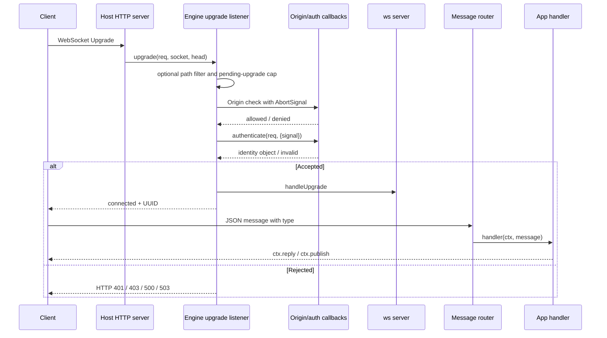

# Upgrade, Dispatch, Send and Shutdown Flow

1. The host emits an upgrade event. If a configured `path` doesn't match, SocketCore **returns without consuming the socket**. If no other listener owns it, the host must handle rejection.
2. Origin check occurs **before** authentication. Empty/missing Origin is permitted, but the identity callback is mandatory. Both checks have independent deadlines and cooperative abort signals.
3. The engine enforces `maxPendingUpgrades` before work, and `maxConnections` before admission. Timed-out origin/auth provider work may continue occupying a pending slot until its promise settles.
4. On successful `ws.handleUpgrade`, connection manager registers a random UUID and sends `{type:"connected",clientId}`.
5. Per-client and global token buckets and in-flight work limits gate each message. Router parses JSON and invokes the handler for its exact `type`.
6. Handler's context provides `reply`, `subscribe`, `unsubscribe`, `publish`. Buffered send accounting is released by send callbacks or client removal.
7. Ping/pong heartbeat and optional host metrics operate while started. `stop()` detaches upgrades, aborts cooperative callbacks/handlers, stops timers, closes sockets with 1001 and terminates remaining sockets at the drain deadline.

**Latency and operations:** There is no client reconnection strategy, persistent storage, distributed group membership, automated TLS or host process supervision. Production p95/p99/CPU/RSS cannot be inferred from CI's 100-client loopback experiment.
