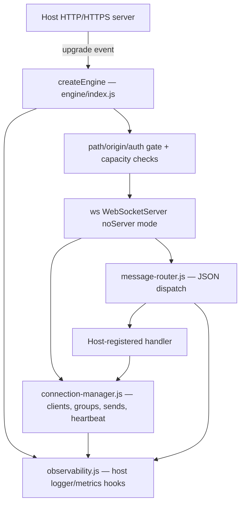

# Architecture and Module Boundaries

**Only public npm root export:** `createEngine` from `engine/index.js`. The other modules are private by `package.json.exports`. The returned `connectionManager` and `messageRouter` are accessible from an engine instance and documented at [API](../api/index.md).

| File | Actual role | Distribution |
| --- | --- | --- |
| `engine/index.js` | Factory; upgrade checks, callbacks, global admission, lifecycle | **Public root factory implementation** |
| `engine/config.js` | Defaults and strict option validators | Private helper |
| `engine/connection-manager.js` | In-memory clients/groups, buffered send accounting, heartbeat/drain | Private implementation exposed through returned manager |
| `engine/message-router.js` | Typed JSON dispatch and generic error replies | Private implementation exposed through returned router |
| `engine/observability.js` | Safe `name`/`code` logger and hook-isolated metrics | Private helper |
| `handlers/status.handler.js` / `handlers/command.handler.js` | Sample application-specific handlers | **Repository only**, not in npm |
| `app.js` | Sample HTTP listener and `AUTH_TOKENS` parser | **Repository only**, not in npm |
| `load-test/server.js` / `test/load/clients.py` | Loopback synthetic performance experiments | Repository test tooling |
| `load-test/pu06-preflight.js` | Offline-only target qualification completeness gate | Repository test tooling |
| `.github/workflows/*.yml` | Node matrix, security, loopback smoke, approved npm release | Repository workflows |

No schema-driven RPC, Redis, database, background worker pool, cross-process pub/sub, session-token store, or hosted WebSocket gateway is included. See [execution flow](execution-flow.md).
